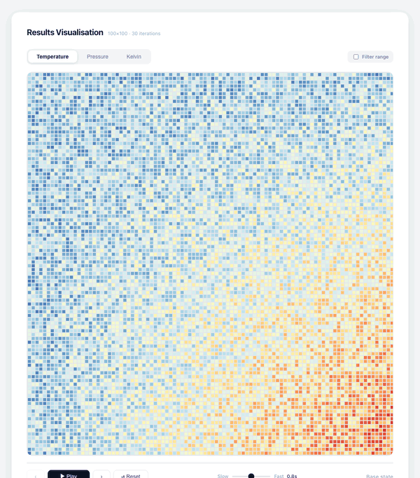
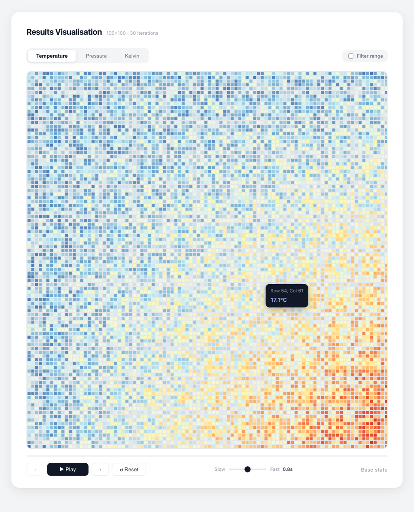
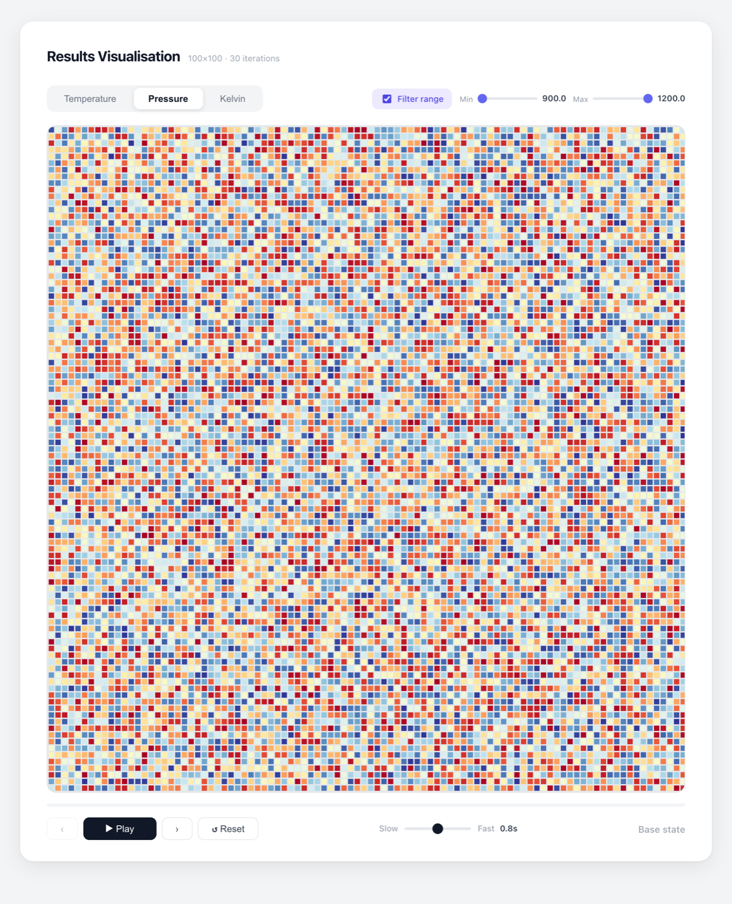

# Simulation results visualiser

A React and TypeScript app for exploring simulation results: a 100 x 100 grid of temperature and
pressure readings over 30 iterations. Each cell is coloured by value, drawn on a canvas, and
played back as an animation. Data streams in from a small Express API in pages, so playback can
start before everything has loaded.

Built as a front-end take-home assessment for PhysicsX.



| Hover for exact values | Pressure, with a range filter |
|---|---|
|  |  |

## Features

- **Canvas-rendered heat map** of 10,000 cells, with colours precomputed per iteration and repainted
  only when needed
- **Temperature, Pressure and Kelvin** views, each with its own colour scale
- **Tooltip** with the row, column and exact value under the cursor
- **Playback:** play and pause, step forward and back, reset, and a speed slider
- **Range filter** to highlight only the values between a chosen minimum and maximum
- **Paginated loading:** the first iterations arrive with the grid and the rest load in the
  background, and stepping forward waits until the next page is ready
- **Tests:** 53 Vitest tests covering parsing, API shape validation, delta application, colour
  scales, the visualisation component and the server

## Quick start

Requires Node.js 18 or later. Run the API and the app in two terminals:

```bash
npm install
node server.js     # API on http://localhost:5001
npm run dev        # app on http://localhost:5173, then open /resultViz
npm test           # run the tests
```

`generate_test_data.py` creates the large `data_test.json` data set the server uses.

The rest of this README is my write-up of the approach, as submitted.

---

# Objective:
A visualiser for a grid of temperature or pressure data, with the ability to step through iterations of data and see how the values change over time. The grid should be colour-coded to indicate the range of values, and there should be a tooltip that shows the exact value when hovering over a cell. The user should also be able to play an animation of the data changing over time, with controls to adjust the speed of the animation.

## Basic Requirements:
1. Grid Rendering
2. Data Preperation and Visualisation
2. Interactivity 
3. Visualisation (at scale)
4. Data Transmission 

# Non-Techincal side of the Solution:

## Why are we doing this?
Since we are talking about 'Temperature' or 'Pressure' data, I am assuming a 2D/3D object which is under testing.

[Just a little physical setting to give meaning to the data]
Let's considere a Porsche 911 having pressure sensors across the car's body to monitor the pressure at different points. The grid could represent the car's surface, and the colour-coding could indicate areas of high or low pressure. This would allow engineers to visualize how the pressure changes across the car's surface during testing or real-world driving conditions.

L ≈ 4.54 m, W ≈ 1.85 m, H ≈ 1.30 m
Bounding box surface area: A=2(LW+LH+WH) ≈33.4 m2
Adjusting for rounded car shape: Cars typically have ~65–75% of the box surface area due to curvature and wheel cutouts ≈23 m2 or 230,000 cm2

Assuming a 'Flush Pressure Taps', diameter: ~2–6 mm
Surface sensing area: roughly 1–5 mm²

Assuming each sensor is about 10 cm apart, I can calculate the number of sensors needed to cover the car's surface: ~2300

Although this 2300 for a single iteration - I don't need to send 'each' sensor's data for every iteration. I need to show the data based on 'viewport' of the grid. For example, if the user is only looking at a 10x10 section of the grid, I can send data for that section only, which would be 100 cells per iteration.

Since I am talking about a 3D object on a 2D screen, a user will only view it from a single 'viewport' which may only show a portion of the grid at a time. Therefore, I can optimize data transmission by only sending the relevant data for the current viewport, rather than the entire grid. This would significantly reduce the amount of data sent to the client and improve performance.

------
# Technical side of the Solution:

## How to run

**Server:**

```bash 
node server.js
```

**React app:**
```bash
npm install && npm run dev
```

Then open the app in the browser at http://localhost:5173

**Tests:**
```bash
# React app:
npm run test 
```

------
## Part 1. Server

### Total data? 
The data json is 3x3 for 11 steps = 99 cells. I can just send over the 'entire' data for the 

To consider scalability, I can implement pagination on the server side to limit the amount of data sent to the client at once. For example, I could send data for 2 iterations at a time (200 cells), and the client can request the next set of iterations as needed.


### Pagination:
Rather than waiting for all iterations to load before showing anything, the server now sends them in small chunks of 3 at a time. The first chunk loads alongside the grid so the user can start playing immediately. The rest arrive quietly in the background — each chunk gets processed and added to what's already there. If the user tries to step forward before the next chunk has arrived, the button is simply disabled until it's ready.

### Testing with larger datasets:
To test the performance of the application with larger datasets, I can simulate a larger grid (e.g., 100x100) and generate random data for it. This would allow me to evaluate how well the application handles larger datasets and identify any potential bottlenecks or performance issues that may arise with larger grids. (generate_test_data.py and data_test.json)

Further possible optimisations in the API:
### 3D Object:
I believe a large amount of gain can come from optimising for 3D objects specifically. Since the grid is representing a 3D object, I can take advantage of the fact that users will only be viewing a portion of the grid at a time (the viewport). Therefore, I can optimize data transmission by only sending the relevant data for the current viewport, rather than the entire grid. This would significantly reduce the amount of data sent to the client and improve performance.


### Server Sent Events:
Currently we're using a simple API endpoint to fetch the data, but for a more real-time experience, I could consider implementing Server-Sent Events (SSE) or WebSockets. This would allow the server to push updates to the client as they happen, rather than the client having to poll for new data. This would create a smoother and more responsive user experience, especially if the data is being updated frequently. Real time data from a jet engine test bench, perhaps.


### Transmission:
Smoother transmission can be acheived if I implement a queuing system on the server side and client side to handle the API responses. This would allow me to manage the flow of data and ensure that the client receives updates in a timely manner without overwhelming it with too much data at once.

## Part 2. UI
### Grid structure:
For a 3x3 grid, I have taken left to right and top to bottom as the order of the cells. So, the first cell (0,0) would be the top-left corner, and the next cell (0,1) would be the top-middle, and fourth cell (1,0) would be the left middle. This way, I can easily map the data from the API to the correct cells in the grid.

If I increase from 3x3 to 10×10 that's 100 nodes, at 100×100 it's 10,000, at 1000×1000 it's 1,000,000 — all causing layout, style recalc, and React diffing overhead.

Instead I should create a cavas element which is used to render the grid. This way, I can draw the grid and update it efficiently without worrying about DOM overhead. I can use the canvas API to draw the grid and update it as needed based on the data received from the API.

And for the tooltip I can just use coordinate rather than DOM event bubbling, and a ResizeObserver redraws on container resize.

### Precompute colours:
When the data loads, I work out the colour for every cell at every step upfront and store it — so when you hit Play, there's nothing left to calculate. The colour range is fixed from the full dataset so colours stay consistent as you step through. Each step only processes the cells that actually changed, not the whole grid. At playback time, moving to the next step is just looking up what I already prepared — no recomputing, no React re-rendering, just a single canvas redraw.

### Handling missing data and errors:
Missing or bad values — if a cell has no data, or the value can't be read (empty, null, a string that isn't a number), I show it as a neutral grey with a "—" label rather than letting it silently turn black or break the colour scale. Bad values are excluded when calculating the colour range so one broken cell doesn't skew the whole grid.

Bad API responses — before I try to use the data, I check it has the shape I expect. If something is missing or wrong, I show a clear error message ("API error: grid.pressure is not an array") rather than a cryptic crash.

Out-of-range updates — if an iteration says "update cell (row 99, col 99)" but the grid is only 3×3, I skip it rather than writing into memory I don't own.

### Repaint on demand:
Rather than trying to update the grid every time new data arrives, I can use a flag to track whether a repaint is needed. When new data comes in, I set the flag to true. Then, in the animation loop, I check the flag and only redraw the grid if it's set. This way, I avoid unnecessary redraws and improve performance.

### Reserve Canvas height and width:
To prevent layout shifts when the grid is first rendered, I can set a fixed width and height for the canvas element based on the expected grid size. This way, the canvas will reserve the necessary space in the layout from the start, and I won't have to worry about it resizing as data loads in.

### Slider to control animation speed:
I can add a slider input to allow users to adjust the animation speed. I have assumed the fastest speed to be 5 iterations per second and the slowest to be 0.5 iterations per second. The slider can be implemented using an HTML range input, and I can use its value to control the timing of the animation loop.

### States:
I don't believe an external state library is required since we're only managing a few pieces of state (current step, animation speed, whether the animation is playing). Adding Redux or Zustand would be overkill.

### Filter:
Since I precompute the cells at every step upfront, the filter can compute during render time efficiently. When the filter is enabled, I pass a min-max range to the canvas draw functions. Each cell's display value is parsed back to a number and compared against the range. Cells inside the range are drawn at full opacity; cells outside are drawn at 12% opacity.

When you switch metrics, the filter resets. This is intentional: temperature and pressure operate on completely different numeric scales, so carrying a filter from one to the other would produce meaningless results.

I deliberately avoided precomputing filtered snapshots. Doing so would multiply memory usage by the number of possible filter states, which is unbounded. Since the filter check is just a numeric comparison per cell and runs in the browser's native canvas compositor (not through React), the cost is negligible even for large grids.

### Further possible optimisations:
snapshotStep and the usePrecomputedData run synchronously, so if the dataset is large enough to cause a noticeable delay; I could consider offloading the precomputation to a Web Worker. This would allow the main thread to remain responsive while the data is being processed in the background. The worker could post messages back to the main thread with progress updates or when the precomputation is complete, allowing for a smoother user experience even with larger datasets. Most useful at the scale of 10000×10000 grids where precomputation could take several seconds. For smaller grids, the overhead of setting up a worker might outweigh the benefits.
